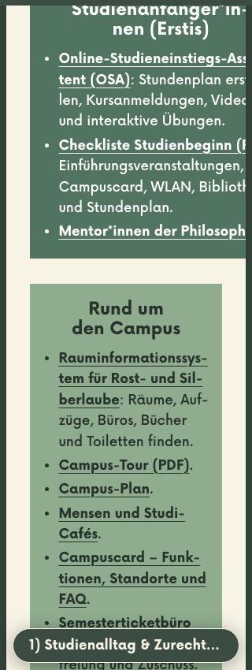
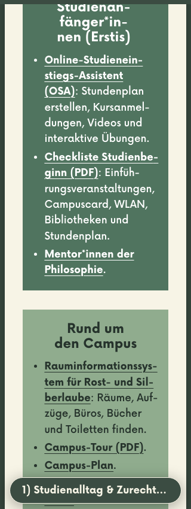

# Philo4all accessibility audit and improvements

This is the supporting record of the HTML audit and retained fixes. The main public report is now the [original PDF versus latest HTML comparison](ACCESSIBILITY_REPORT.md).

**Test date:** 26 October 2026 (Europe/Berlin).  
**Target:** WCAG 2.2 Level AA, where applicable.  
**Baseline source revision:** `5640013fc2f635e233b9ea3cc860dccbb042b282`. The improvements described here are uncommitted changes on top of that revision.

## Executive summary

The HTML reader provides a useful alternative way to read the Philo4all guide. It already offered structured text, chapter links, a keyboard skip link, responsive layouts, and reduced-motion support. This audit found and fixed three confirmed accessibility failures:

- At 320 CSS pixels wide, part of the first-year information extended beyond the page and was cut off.
- In the light theme, inactive navigation dots had insufficient contrast against their background.
- An English passage inherited the page's German language setting.

The changes also give chapter links an explicit heading focus destination and improve navigation when JavaScript is disabled. The guide's text, link destinations, illustrations, and overall visual design have been preserved; the English passage received language markup only. A comparison of the generated main content before and after these changes found identical normalized text, all 161 link destinations in the same order, and unchanged image sources/alternatives; see [content-preservation evidence](accessibility-evidence/content-preservation.json).

**Overall assessment:** the tested local build is improved, with the identified failures corrected. Automated scans alone missed the original clipping and dot contrast problems. Passing the checks below is **not a WCAG conformance claim or accessibility certification**. Screen-reader use, other browser engines, native browser zoom, and further testing with disabled students remain necessary.

The fixes have **not been deployed**. The public website was inspected as a baseline; after-change results apply to the local production build.

## Scope, method and environment

### What was inspected

- The repository's Astro components, CSS, design tokens, German/English content, reader scripts, and optional AI chat.
- The [public HTML implementation](https://philo4all.zavalit.workers.dev/): one Chromium desktop capture and axe scan, HTTP 200. See [deployment observations](accessibility-evidence/deployed.json).
- The locally built single-page reader: cover, contents/team sheet, nine chapters, footer, page navigation, previews, and the optional `?ai` dialog.
- The [original FU PDF](https://www.geisteswissenschaften.fu-berlin.de/we01/studieren/studienberatung/philo4all/Kopie-von-Philo4all_aktuell_Juli_2025.pdf): metadata, structural tags, text extraction from all 12 pages, link annotations, and a rendered inspection of page 5, which contains the campus map.
- The [official FU Philo4all page](https://www.geisteswissenschaften.fu-berlin.de/we01/studieren/studienberatung/philo4all/index.html), for the project's context and source link. That separate FU website was not audited for conformance.

### How it was tested

| Method | Coverage and limits |
| --- | --- |
| Source review | HTML semantics, heading levels, landmarks, names, image alternatives, language, links, colors, motion preferences, and focus handling. |
| Existing axe/Playwright suite | Light/dark × 390/1280px × normal/reduced motion: eight combinations. Each scans the reader and chat dialog, answer, and error states: 32 axe scans per run. Chat responses are mocked; no questions are sent to a live AI service. |
| Extended audit | Light/dark × 320/1280px, axe at the cover and advice chapter: eight further scans. Also checks text clipping, skip links, chapter focus, text spacing, enlarged default text, reduced motion, and navigation without JavaScript. |
| Keyboard actions | Playwright sends Tab/Enter/Escape and Shift+Tab in the dialog. Forward traversal of the page at 390×850, 1920×1080 and 1280×300 checks 164, 174 and 174 focus stops respectively. Visibility is sampled after scrolling settles; focus outlines are checked through computed styles. This is scripted browser testing, not screen-reader testing. |
| Visual review | Before/after screenshots inspected for the narrow layout, keyboard focus, desktop themes, enlarged text, and no-JavaScript navigation. Screenshots are viewport captures, not a capture of every line of the guide. |
| Reflow and text adjustments | 320px viewport, plus 200% root font size at 1280px. The 320px viewport represents the available width of a 1280px viewport at 400% zoom; **native browser zoom was not operated**. Text-spacing overrides use 1.5 line height, 2em paragraph spacing, .12em letter spacing and .16em word spacing. Text bounds are checked against clipping ancestors, not just the page scrollbar. |
| Contrast | Existing token checks for principal text/background and focus pairs, plus a new opacity-aware calculation for inactive navigation dots. These checks do not establish the contrast of every pixel over illustrations or photographs. |
| PDF comparison | Read-only structural inventory and exact URL comparison with the generated HTML. Topic-by-topic comparison of extracted PDF text and MDX. No PDF/UA validator or PDF screen-reader session was run. |

Environment: macOS 26.6.2, Node.js 22.23.3, pnpm 11.25.0, Astro 7.4.0, Playwright 1.64.1, headless Chromium 156.0.8078.4, axe-core/@axe-core/playwright 4.14.0, Poppler 26.10.0 and pypdf 6.21.2. Viewports are in CSS pixels; these are emulated sizes, not physical-device tests. The existing JavaScript dependencies were reused. pypdf was installed only in a temporary Python environment for the document inspection.

## Findings and changes

**Confirmed failure** means there is direct source or rendered evidence against the cited requirement. **Potential risk** means a concern needs further human or assistive-technology evaluation. A failed custom assertion is not automatically a WCAG failure. Severity reflects practical impact, not a certification score.

| ID / severity | Classification and WCAG criterion | Evidence and impact | Change | Status |
| --- | --- | --- | --- | --- |
| A01 / High | **Confirmed failure:** 1.4.10 Reflow; also reproduced with 1.4.12 Text Spacing overrides | At 320px in both themes, seven text nodes in the first-year panel extend beyond the 304px sheet and are clipped. Students can lose parts of links and instructions without a horizontal scrollbar. | Narrow chapter layouts now stretch panels to the available width instead of retaining start alignment and allowing an oversized panel. See `Chapter.module.css`. | **Fixed and verified** in the text-bounds checks and screenshots below. |
| A02 / Medium | **Confirmed failure:** 1.4.11 Non-text Contrast | Inactive desktop dots are the visible identifiers of the chapter controls. At opacity .40 they measure **2.74:1** against the light desk, below 3:1. Dark was **3.16:1**, already passing. | Increased inactive opacity to .65. Added an opacity-aware contrast regression check. | **Fixed and verified:** light **4.58:1**, dark **5.93:1**. [Before](accessibility-evidence/before-controls.json) / [after measurements](accessibility-evidence/after-controls.json). |
| A03 / Medium | **Confirmed failure:** 3.1.2 Language of Parts | The English explanation for incoming students in chapter 8 had no language override within `<html lang="de">`. Speech software could apply German pronunciation to the passage. | Wrapped the English link and explanation in `lang="en"`; words and destination are unchanged. | **Markup verified** by the browser regression test. Actual voice switching still needs screen-reader testing. |
| A04 / Medium | **Potential assistive-technology risk**, related to 2.4.3 Focus Order; no confirmed criterion failure assigned | After activating a chapter link, `document.activeElement` became `BODY`. The next Tab nevertheless reached a link in the destination chapter in the baseline test. The original behavior therefore does not prove a keyboard failure, but gives no explicit heading focus destination. | Chapter jumps now focus the destination heading after native fragment navigation. Headings have `tabindex="-1"`, adding no ordinary Tab stops. Modified clicks retain native behavior. | **Focus transfer verified** at 320/1280px in both themes. Screen-reader announcement and virtual-cursor behavior remain untested. |
| A05 / Low | **Confirmed usability limitation**, not recorded as a WCAG failure | Without JavaScript on mobile, a native navigation popover stayed open after following its link. Escape could dismiss it; it was not a demonstrated keyboard trap. | Before reader enhancement, navigation appears as ordinary links in the document and the floating toggle is hidden. | **Verified** at 390px with JavaScript disabled: the destination hash is correct and no popover remains open. |

### Before and after

| Check | Before | After |
| --- | --- | --- |
| Extended custom audit | **37/46 checks passed; 9 unsuccessful assertions** | **46/46 passed** |
| Breakdown of those nine assertions | Four clipping/text-spacing cases; four missing explicit heading-focus cases; one no-JavaScript menu case | All corrected; the table above distinguishes WCAG failures from enhancements |
| Extended axe scans | Eight scans, **0 reported violations** | Eight scans, **0 reported violations** |
| Existing reader/chat suite | Passed its original eight-combination matrix | Passed, with added checks for dot contrast, English language markup, modal focus containment in both Tab directions, and hovering over previews |
| Principal token contrast checks | Passed | Passed; regular-text pairs range from **5.24:1 to 12.01:1** across the two themes |
| Page keyboard visibility and outlines | Passed after waiting for scrolling to settle | Passed at all three traversal sizes; no fully obscured focus stops detected by the sampling check |

The assertion totals are test cases across several settings, **not counts of distinct accessibility defects**. Contrast and the English-language finding have separate evidence/regression checks and are not included in those nine baseline assertions.

Raw extended results: [before.json](accessibility-evidence/before.json) and [after.json](accessibility-evidence/after.json). Axe also returned **incomplete color-contrast checks** in every extended scan; these are unresolved automated assessments, not passes or confirmed failures. The raw files retain the affected selectors. Token checks and visual review supplement them but do not replace a complete human contrast review.

The clearest example is the first-year panel at 320px. The screenshots start at the same heading; its top is at the viewport edge in both captures. On the left, text disappears at the sheet's right edge. On the right, it wraps inside the panel.

| Before | After |
| --- | --- |
|  |  |

Further examples: [mobile keyboard focus](accessibility-evidence/after-chapter-keyboard-320.png), [dark desktop](accessibility-evidence/after-advice-dark-1280.png), [text-spacing overrides](accessibility-evidence/after-text-spacing-320.png), [200% default text](accessibility-evidence/after-text-200-percent.png), and [navigation without JavaScript](accessibility-evidence/after-no-js-390.png).

### Passed checks to preserve

- **Structure and orientation:** one `main`, one H1, ten H2s and 39 H3s, with no skipped heading levels in the main content. The document has a descriptive title and German language metadata. Page navigation and contents navigation have names; sheets are labelled articles.
- **Keyboard operation:** the skip link transfers focus to `main`; chapter navigation and deep links work; page links reflect the current chapter. Checked focus stops have outlines. Navigation previews and the chat tooltip dismiss with Escape; previews remain open when hovered. The native modal prevents focus moving into the underlying page, closes with Escape and returns focus to its launcher. Browser chrome can remain reachable at the Tab boundary; that is not treated as a page focus escape.
- **Images and links:** all main-content images have an `alt` attribute. Decorative illustrations are hidden from assistive technology. The logo and portraits are named; the campus image has alternative text and adjacent room information. Content links generally name their destinations, and body links are underlined. All local links and fragment references pass the internal-link check. Image-description quality still needs user review.
- **Layout and input targets:** no document-wide horizontal overflow or detected horizontal text clipping in the tested after-change states. Desktop dots have 24×24px link boxes; mobile navigation and primary chat controls use 44px minimum heights. Inline prose links fall under the inline target-size exception; this is not a blanket 44px-target claim.
- **Motion and themes:** both color schemes retain readable principal color pairs. Reduced motion disables paper stacking, smooth scrolling, chat entry animations and animated waiting dots. The waiting text remains available.
- **Chat states:** labels, empty dialog, mocked answer/citations, rate-limit error/retry, long answers, reopening, and keyboard containment pass the scripted checks. Live response quality and live-service behavior are outside this result.

## PDF versus HTML

### What the PDF evidence does and does not show

The downloaded file is a **tagged Canva PDF with German language metadata and extractable text on every page**. It contains 202 URI link annotations and 104 internal GoTo annotations. It must not be described as image-only, untagged, or lacking links. Its filename mentions July 2025, its internal creation date is July 2025, and the visible cover says May 2025.

The structural inventory found 55 Figure elements without `/Alt` or `/ActualText`, and inconsistent heading levels: for example, the Technik chapter is H2 while its Software subsection is H1. These are direct structural observations. The importance of each figure, actual reading order, and the experience in a particular PDF reader need further evaluation; this audit does not declare every figure a failure or certify PDF/UA status. See [PDF inspection evidence](accessibility-evidence/pdf-inspection.json).

| Area | Evidence-based comparison |
| --- | --- |
| Small-screen reading | The PDF uses fixed pages of approximately 810×1440 points. The HTML uses wrapping text and single-column panels on narrow screens; the corrected 320px layout was tested. No PDF viewer's reflow mode was tested, so PDF reflow failure is not claimed. |
| Heading navigation | The PDF's tag levels are inconsistent in the examples above. The HTML exposes a consistent H1 → H2 chapter → H3 panel structure. Screen-reader navigation itself was not exercised in either format. |
| Image information | HTML separates decorative art from meaningful images and supplies nearby room information for the campus map. The PDF's Figure tags lack alternatives in the inventory. Whether other PDF text provides an equivalent for each image was not established. |
| Navigation | The PDF already contains links. HTML adds a skip link, named navigation, explicit chapter focus, and a current-chapter indicator. Only the HTML's browser interaction was tested. |
| User preferences | HTML responds to color-scheme and reduced-motion preferences. PDF display behavior depends on the reader; no comparative PDF dark-mode or magnification test was performed. |

### Content parity: retained topics, not an exact transcription

All nine topic areas, their order, the introductory purpose, and the four named team members are represented. The existing HTML **condenses and sometimes rephrases** the PDF. The README now describes that accurately. The following is a topic-level cross-check, not a word-for-word approval by the Studi-Team.

| PDF page(s) | HTML section | Comparison |
| --- | --- | --- |
| 1 | Cover | Introduction and contact purpose retained; contact destination differs. |
| 2 | Contents and team | Nine topics and four names retained; descriptions condensed. |
| 3 | 1. Studienalltag & Zurechtfinden | General support, first-year resources and campus resources present. |
| 4 | 2. Studienorganisation | Study organization, Lehramt and ABV/languages present. |
| 5 | 3. Institutsleben | Institute resources, events and rooms present; room labels also expressed as adjacent text. |
| 6 | 4. Wissenschaftliches Schreiben | Documents, writing support and libraries present; no separate flyer item in the HTML. |
| 7 | 5. Technik | Network, platforms, printing, software and help present; the €5 printing statement includes a request to check current conditions. |
| 8–9 | 6. Beratungsstellen | Both PDF pages combined into one HTML chapter, including general, mental-health, AStA and specialist support. |
| 10 | 7. Wohnen & Finanzieren | Funding, jobs, housing and After Work present; an event-specific link has become a general course listing. |
| 11 | 8. Internationales | International resources and Erasmus present; incoming-student explanation condensed. |
| 12 | 9. Über die Uni hinaus | Sport, workshops, music, engagement and sustainability present; several descriptions and destinations differ. |

The reproducible URL inventory found **139 unique PDF URIs**, **138 unique external/mail links in the HTML**, and **120 exact matches**. Nineteen PDF URLs and eighteen HTML URLs differ between the sets. This comparison strips surrounding PDF whitespace only: redirects, different schemes, anchors and equivalent resources are not treated as matches. These counts **do not prove nineteen missing resources**. The complete sets of differences are in [pdf-inspection.json](accessibility-evidence/pdf-inspection.json).

Several changes predate this audit. [LINK-STATUS.md](../LINK-STATUS.md), dated 23 October 2026, records replacement-link work and two editorial questions concerning After Work and FUndgrube/fainin. Those destinations were not revalidated by this audit. Photo-credit links visible in the PDF are also absent from the HTML link inventory; attribution and publication rights need editorial review. Accessibility fixes did not change those destinations or credits.

## Remaining limitations and recommended follow-up

1. **Test with people using assistive technology.** Arrange German-language VoiceOver/Safari and NVDA/Firefox or Chrome sessions. Test heading/landmark navigation, chapter announcements, English pronunciation, modal entry/exit, long chat answers and error announcements. No screen reader, braille display, speech-control or switch-input testing is claimed here.
2. **Broaden browser and low-vision checks.** Test Safari and Firefox, physical mobile devices, native 200%/400% zoom, increased operating-system text size, and forced-colors/high-contrast mode. The viewport and default-font simulations are useful checks, not coverage of those environments. The clipping detector checks horizontal text bounds; it does not prove that every image, decoration, or vertical overlap is correct.
3. **Review axe's incomplete contrast results.** Check text over graphics and every panel in realistic reading states, including stacked sheets and hover/focus states. A sampled unobscured point or a CSS outline is not a complete human assessment of focus visibility.
4. **Obtain editorial parity approval.** Have the Studi-Team approve condensed wording, changed links, room descriptions, credits and current advice. External destinations, linked PDFs and their accessibility are outside the HTML audit. A working local link is not proof that an external service remains correct or accessible.
5. **Retest the actual deployment after publication.** Run the suite against the released revision, check for browser console errors, and retain the revision/date with future reports. There is no site accessibility contact or formal accessibility statement added by this task; the university should choose responsible contacts and any required statement through its own process.

## Reproduce the checks

Run from the repository root. The normal suite uses the production output in `dist/client`, serves it on a temporary loopback port, and closes the browser/server afterwards. Rebuild after source changes. Do not run the tests against stale `dist` output.

```sh
pnpm install --frozen-lockfile
pnpm exec playwright install chromium
pnpm run check
pnpm run test:chat
pnpm run build
node scripts/check-internal-links.mjs
pnpm run test:a11y

# Export extended evidence separately (choose a new phase name to preserve this audit).
A11Y_OUTPUT=docs/accessibility-evidence A11Y_PHASE=current \
  node tests/accessibility-audit.mjs

# Optional: run that extended audit against a running/released site.
A11Y_URL=https://philo4all.zavalit.workers.dev \
  A11Y_OUTPUT=/tmp/philo4all-live-audit A11Y_PHASE=live \
  node tests/accessibility-audit.mjs
```

The suite is already called by `.github/workflows/ci-deploy.yml`; expanding `test:a11y` adds these regression checks to CI. A failure causes a nonzero exit. No new JavaScript packages were added.

To reproduce the PDF inventory independently, using Poppler and a temporary Python environment:

```sh
mkdir -p /tmp/philo4all-pdf-review
curl -fL 'https://www.geisteswissenschaften.fu-berlin.de/we01/studieren/studienberatung/philo4all/Kopie-von-Philo4all_aktuell_Juli_2025.pdf' \
  -o /tmp/philo4all-pdf-review/original.pdf
shasum -a 256 /tmp/philo4all-pdf-review/original.pdf
pdfinfo /tmp/philo4all-pdf-review/original.pdf
pdftotext -layout /tmp/philo4all-pdf-review/original.pdf /tmp/philo4all-pdf-review/original.txt
pdftoppm -f 5 -l 5 -scale-to 1200 -png -singlefile \
  /tmp/philo4all-pdf-review/original.pdf /tmp/philo4all-pdf-review/page-05
python3 -m venv /tmp/philo4all-pdf-review/venv
/tmp/philo4all-pdf-review/venv/bin/pip install pypdf==6.21.2
/tmp/philo4all-pdf-review/venv/bin/python scripts/inspect-source-pdf.py \
  /tmp/philo4all-pdf-review/original.pdf dist/client/index.html
```

Audited PDF SHA-256: `88e7e7b09c330014cc395f71122cd7d71c65c08b3a792faf954f5b9370266b86` (10,651,836 bytes). If the download changes, repeat the comparison; the report does not automatically apply to a newer PDF. The full PDF is not duplicated in this repository.

### Execution results and evidence

| Command/check | Recorded result |
| --- | --- |
| `pnpm run check` | 37 files checked; 0 errors, 0 warnings, 0 hints. Token, CSS and content checks passed. |
| `pnpm run test:chat` | 30 tests passed; 0 failed. |
| `pnpm run build` | Production build completed. |
| `node scripts/check-internal-links.mjs` | Passed across one generated HTML document. |
| Baseline extended audit | Nonzero exit, as expected: 37/46 passed, 9 unsuccessful assertions. Reproduce the clipping at 320px by opening chapter 1; reproduce missing heading focus by opening the page menu and activating chapter 4 with Enter. |
| After-change accessibility suites | Existing reader/chat suite passed; extended audit 46/46 passed, 0 axe violations in its eight scans. See [verification transcript](accessibility-evidence/verification.txt). |
| Public-site baseline | HTTP 200; desktop axe scan reported 0 violations and 3 incomplete color-contrast nodes. This is a limited baseline scan, not after-change validation. |

This execution environment initially denied loopback servers/Chromium (`EPERM`), and one chat unit test likewise needed loopback access. Those commands were rerun with permitted local-process access; these were environment restrictions, not product failures. Build/check logs were redirected to a writable temporary directory with `WRANGLER_LOG_PATH=/tmp/philo4all-audit/wrangler-build.log` (or `wrangler-check.log`).

### Standards reference

Criterion names and thresholds follow the [W3C WCAG 2.2 Recommendation](https://www.w3.org/TR/WCAG22/), particularly [Reflow](https://www.w3.org/TR/WCAG22/#reflow), [Text Spacing](https://www.w3.org/TR/WCAG22/#text-spacing), [Non-text Contrast](https://www.w3.org/TR/WCAG22/#non-text-contrast), [Language of Parts](https://www.w3.org/TR/WCAG22/#language-of-parts), [Focus Order](https://www.w3.org/TR/WCAG22/#focus-order) and [Target Size (Minimum)](https://www.w3.org/TR/WCAG22/#target-size-minimum). This report records scoped evidence and remaining work, not a full-page conformance evaluation of every WCAG success criterion.
