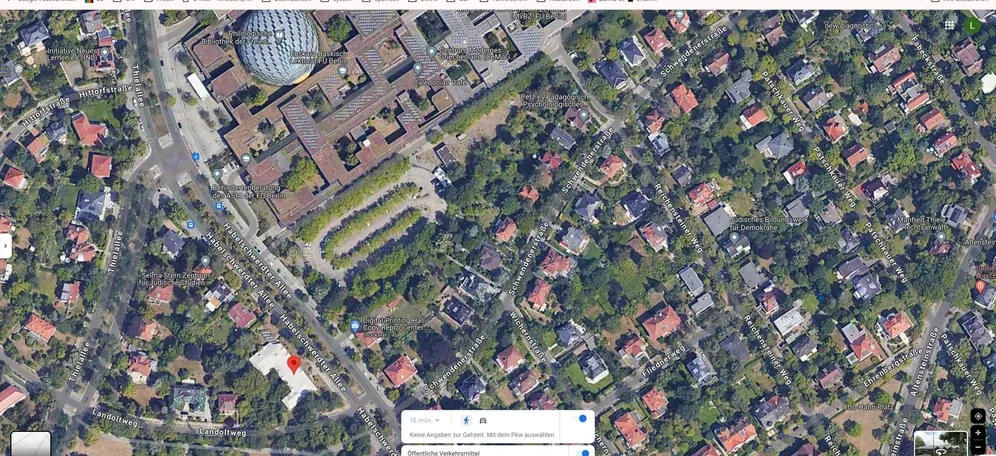
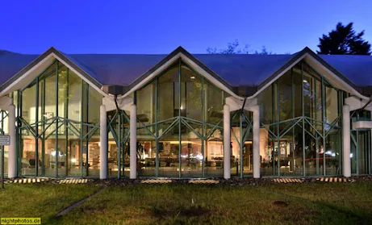

<Panel title="Was geht am Philo-Institut?" tone="pale">

- [Institutsleben am Philosophie-Institut](https://www.geisteswissenschaften.fu-berlin.de/we01/institut/institutsleben/index.html).
- [Fachbereich Philosophie und Geisteswissenschaften](https://www.geisteswissenschaften.fu-berlin.de/index.html).
- [Startseite des Instituts für Philosophie](https://www.geisteswissenschaften.fu-berlin.de/we01/index.html).
- [Kontaktdaten der Lehrenden](https://www.geisteswissenschaften.fu-berlin.de/we01/institut/mitarbeiter/index.html).
- [Vertrauensdozierende](https://www.geisteswissenschaften.fu-berlin.de/we01/studieren/Vertrauensdozierende/index.html).
- [Sokrates – zentrale Mailingliste](https://lists.fu-berlin.de/listinfo/sokrates) für Philosophie-Studierende.
- [Wichtige Dokumente und Formulare](https://www.geisteswissenschaften.fu-berlin.de/we01/studieren/studium/download/index.html): Leitfaden für Hausarbeiten, Eigenständigkeitserklärung, Anrechnungen, Abschlussarbeitszulassungen und Ordnungen.

</Panel>

<Panel title="Studentisches Kolloquium" tone="pale" span={5}>

[Studentisches Kolloquium für Haus- und Abschlussarbeiten](https://lists.fu-berlin.de/pipermail/sokrates/2022-October/msg00003.html).

</Panel>

<Panel title="Angebote" tone="forest" span={7} align="end" bleed="end">

- [Fachspezifische Abschlussberatungen („Endspurt“)](https://www.geisteswissenschaften.fu-berlin.de/studium/abschlussberatung/index.html).
- [1.-Generation-Stammtisch](https://www.geisteswissenschaften.fu-berlin.de/we01/institut/termine/index.html).
- [Institutskolloquium](https://www.geisteswissenschaften.fu-berlin.de/we01/institut/institutsleben/index.html).
- [Studentische Fachschaftsinitiative (FSI)](https://www.geisteswissenschaften.fu-berlin.de/we01/institut/FSI/index.html).
- [International Mobility und Erasmuskoordination](https://www.geisteswissenschaften.fu-berlin.de/we01/studieren/International-Mobility/index.html).
- [Ergebnisbericht „Frauen* in der Philosophie“ (PDF)](https://www.geisteswissenschaften.fu-berlin.de/we01/media/Ergebnisbericht-der-Studie-Frauen_-in-der-Philosophie-2014.pdf).

</Panel>

<Panel title="Für Erstis" tone="forest" span={7} align="end" bleed="end">

- [Mentor*innen der Philosophie](https://www.geisteswissenschaften.fu-berlin.de/studium/bachelor/Mentoringprogramm/MentorInnen/index.html).
- [Willkommenswebsite PhilGeist](https://www.geisteswissenschaften.fu-berlin.de/studium/bachelor/Orientierungstage/index.html).
- [Weitere Informationen zum Studienalltag](#thema-01).

</Panel>

<Panel title="Räume: Rost- und Silberlaube" tone="pale" span={9}>

In der Vorlage sind u. a. **Thielallee 43, Seminarraum 1**, **Habelschwerdter Allee 30, Seminarraum 1 und 2** sowie **Glaskasten und Vortragsraum im Untergeschoss** gekennzeichnet. Für barrierefreie Wege und aktuelle Raumlage siehe das [Rauminformationssystem](https://app.guide3d.com/100049/mobile/).

</Panel>
